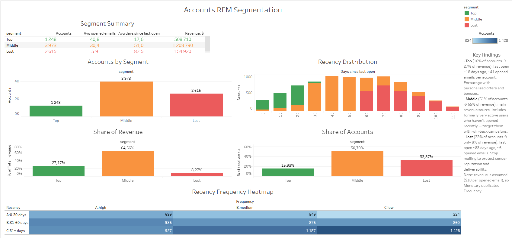

# Accounts RFM Segmentation

Segmentation of email subscribers into **Top**, **Middle** and **Lost** using RFM analysis (Mate Academy, Data Analytics).

🔗 **Tableau dashboard:** [Accounts RFM Segmentation](https://public.tableau.com/views/AccountsRFMSegmentation/AccountsRFMSegmentation)
🔗 **Google Colab notebook:** [Open in Colab](https://colab.research.google.com/drive/1FNQxwwLNuc4k3cBBiYq_P2l-_7pECXdp?usp=sharing)

## Data & Method
- **Source:** BigQuery dataset `DA` (tables `email_sent`, `email_open`, `account_session`, `session`) — see `rfm_dataset.sql`
- **Recency:** days since last opened email (0–30 / 31–60 / 61+)
- **Frequency:** unique opened emails, split into terciles (skewed distribution)
- **Monetary:** assumed $10 per opened email (duplicates Frequency)

## Segmentation rules
| Segment | Rule |
|---|---|
| Top | R = A and F = A/B |
| Lost | R = C and F = B/C |
| Middle | everything else (incl. formerly very active users → win-back) |

## Key findings
| Segment | Accounts | Share of revenue | Recommendation |
|---|---|---|---|
| Top | 16% | 27% | Encourage, personalized offers |
| Middle | 51% | 65% | Keep engaging, win-back campaigns |
| Lost | 33% | 8% | Stop mailing to protect deliverability |

## Tools
SQL (BigQuery) · Python (pandas, seaborn) · Tableau Public
